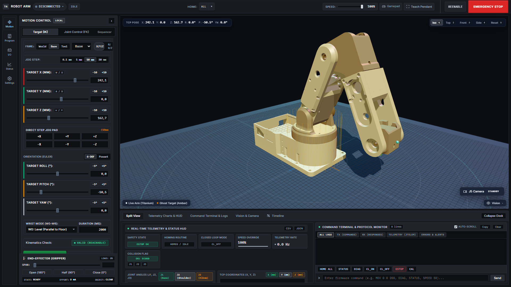
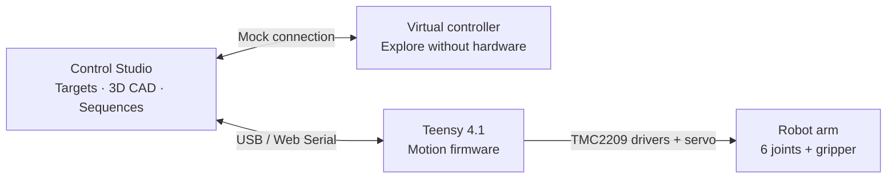

<p align="center">
  
</p>

<p align="center">
  <strong>Precision electronics work. A six-axis arm. One browser-based control studio.</strong><br>
  <sub>Teensy 4.1 · 6 axes + gripper · CAD digital twin · Built-in simulator</sub>
</p>

<p align="center">
  <a href="#try-it-without-a-robot">Try it locally</a> &nbsp; / &nbsp;
  <a href="docs/GETTING_STARTED.md">Setup guide</a> &nbsp; / &nbsp;
  <a href="docs/STPPE_SYSTEM_SPECIFICATION.md">System specification</a> &nbsp; / &nbsp;
  <a href="docs/ROADMAP.md">Roadmap</a> &nbsp; / &nbsp;
  <a href="CONTRIBUTING.md">Contribute</a>
</p>

---

## A workbench for precise motion

STPPE Reborn is a teleoperated robot arm project for delicate electronics servicing and micro-assembly. The aim is to turn hand-operated work under a microscope into controlled, repeatable motion: position a tool, inspect its target in 3D, and build a sequence you can replay.

**Control Studio** brings the robot's CAD model, Cartesian positioning, joint controls, trajectory editing, and telemetry into a browser. A built-in virtual controller lets you explore the software without owning the hardware. The frontend runs directly from source, with no build step.

*STPPE: System Teleoperacyjny do Precyzyjnych Prac Elektronicznych.*

| Position | See the motion | Build a sequence |
| :--- | :--- | :--- |
| Cartesian targets, individual joint controls, and wrist orientation presets. | CAD-based 3D arm, ghost target, workspace overlays, and camera presets. | Waypoint timeline, trajectory preview, and playback controls. |
| Separate target preview and direct-drive modes. | Joint telemetry, tool position, and a command console. | Virtual hardware for experimenting before a bench session. |

## Control Studio preview

[](docs/assets/webcontrol-dashboard.png)

*Control Studio with the robot disconnected: motion controls on the left, CAD viewport in the center, telemetry and console below. Click to inspect the full-resolution image.*

## Try it without a robot

You need **Python 3** and a browser with WebGL. Node.js is only needed to run the JavaScript tests.

```bash
git clone https://github.com/adammotyl22-creator/STPPE-Reborn.git
cd STPPE-Reborn
python WebControl/launch.py
```

The launcher opens your browser and prints the local address. On Windows, `py` can replace `python`; on macOS/Linux, use `python3` if needed. You can also download and extract the repository using **Code → Download ZIP**.

1. Click the **DISCONNECTED** status pill to open connection settings.
2. Enable **Mock**, then click **Connect** to use the virtual controller.
3. In **Target (IK)**, adjust a target and inspect the amber ghost arm. Use **Send to Target (PTP)** to move the simulated arm to it.
4. Open **Sequencer** to explore waypoint editing, then inspect telemetry and the command console.

No frontend build, npm install, or additional Python packages are required for this walkthrough. Keep the launcher running; press `Ctrl+C` in its terminal when finished.

For USB connection, LAN viewing, and troubleshooting, follow the [setup guide](docs/GETTING_STARTED.md).

## From browser to workbench



The browser contains a Wi-Fi/WebSocket transport option as well. It requires a separate compatible bridge; the Python launcher serves the interface and does not relay USB commands. The custom handheld pendant and bridge deployment are part of the [roadmap](docs/ROADMAP.md).

## Project status

| Area | Current position |
| :--- | :--- |
| Control Studio | Browser application, CAD assets, simulator, and automated tests are in this repository. |
| Software checks | **562/562 assertions passed** in the main Node.js suite on 2026-10-13; the Python server smoke check also passed. These are local results, not a CI badge. |
| Physical hardware | The system specification describes an open-loop build with no installed encoders. Firmware alignment and bench validation remain roadmap work. |
| Precision and cost | ≤ 0.5 mm tool-tip positioning and a budget below 2000 PLN are **design targets**, not measured results published here. |

The specification includes intended behavior that is not yet implemented. In particular, the current firmware has no `ENABLE_ENCODERS` / `MANUAL_HOMING` configuration flags, and bare `HOME` starts switch homing. Read the [hardware status notes](docs/GETTING_STARTED.md#connecting-physical-hardware) before using the setup as a hardware guide.

## Next milestones

1. **Align firmware with the physical build** — explicit encoder and homing modes, documented command behavior, and a reproducible build.
2. **Publish bench evidence** — axis calibration, repeatability measurements, and a recorded motion demonstration.
3. **Make the project easier to reproduce** — wiring, bill of materials, assembly notes, and automated software checks.
4. **Extend teleoperation** — a dedicated teach pendant and a documented wireless bridge.

See the [full roadmap and completion criteria](docs/ROADMAP.md).

## Explore the repository

| Start here | What you will find |
| :--- | :--- |
| [Setup guide](docs/GETTING_STARTED.md) | Simulator walkthrough, connection options, and troubleshooting |
| [System specification](docs/STPPE_SYSTEM_SPECIFICATION.md) | Mechanical dimensions, electronics, intended behavior, and implementation caveats |
| [Control Studio](WebControl/) | Browser application, JavaScript modules, styles, and launcher |
| [Teensy firmware](Firmware/Teensy_4.1/IK_Control/IK_Control.ino) | Controller sketch and command handling |
| [Robot geometry](WebControl/urdf/) · [CAD meshes](WebControl/meshes/) | Model definition and geometry used by the viewer |
| [Tests](WebControl/tests/) | Main automated suite and additional focused checks |
| [Contributing](CONTRIBUTING.md) | How to report a problem, propose a feature, or submit a change |

## Run the checks

From the repository root:

```bash
node WebControl/tests/run_tests_node.js
python WebControl/tests/test_server.py
```

The first command checks application logic, protocol handling, kinematics, and UI contracts. The second checks that the local server serves the main application assets. Neither establishes physical positioning accuracy or verifies a firmware build.

Have a reproducible bug or a useful improvement? [Open an issue](https://github.com/adammotyl22-creator/STPPE-Reborn/issues) with your setup and the behavior you observed. Documentation, simulator feedback, and measured bench results are useful contributions too.

---

<p align="center"><sub>STPPE Reborn · Teensy 4.1 + JavaScript + Three.js</sub></p>
