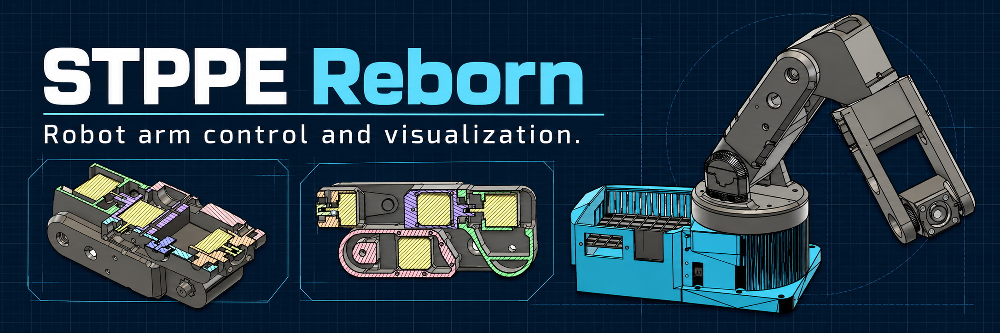

<p align="center">
  
</p>

<p align="center">
  <strong>Teensy 4.1 firmware · Browser control · 3D visualization</strong>
</p>

<p align="center">
  <a href="#quick-start">Quick start</a> &nbsp; / &nbsp;
  <a href="WebControl/">WebControl</a> &nbsp; / &nbsp;
  <a href="Firmware/Teensy_4.1/IK_Control/IK_Control.ino">Firmware</a> &nbsp; / &nbsp;
  <a href="WebControl/PROJECT.md">Technical notes</a>
</p>

---

## From joint motion to a full trajectory

STPPE Reborn brings the firmware and browser control application for a six-axis robot arm into one project. WebControl combines a 3D view of the arm with joint controls, Cartesian positioning, trajectory editing, and telemetry.

| Control | Visualize | Build sequences |
| :--- | :--- | :--- |
| Move individual joints and enter Cartesian targets. | Inspect the arm, target pose, and workspace in 3D. | Arrange motion steps in the trajectory timeline. |
| Connect to the controller through Web Serial. | Follow telemetry and command output. | Explore the interface using the built-in simulator. |

## Quick start

**1. Download the project** using GitHub's **Code → Download ZIP**, then extract it. Or clone it:

```bash
git clone https://github.com/adammotyl22-creator/STPPE-Reborn.git
cd STPPE-Reborn
```

**2. Start WebControl** with Python 3 from the project folder:

```bash
python WebControl/launch.py
```

The launcher opens your browser and prints the local address. It automatically chooses an available port. No frontend build or additional Python packages are needed.

**3. Explore the interface**, or connect your controller using a browser that supports Web Serial. The firmware source is in [`Firmware/Teensy_4.1/IK_Control/`](Firmware/Teensy_4.1/IK_Control/).

## Inside the repository

| Area | What you will find |
| :--- | :--- |
| [`WebControl/`](WebControl/) | Browser application, styles, JavaScript modules, and launcher |
| [`Firmware/Teensy_4.1/`](Firmware/Teensy_4.1/) | Robot controller firmware |
| [`WebControl/meshes/`](WebControl/meshes/) · [`WebControl/urdf/`](WebControl/urdf/) | Robot geometry used by the 3D viewer |
| [`WebControl/tests/`](WebControl/tests/) | Automated checks for WebControl |
| [`WebControl/PROJECT.md`](WebControl/PROJECT.md) | Architecture and implementation notes |

## Open on another device

To open the interface on a phone or another computer on the same trusted Wi-Fi network:

```bash
python WebControl/launch.py --lan
```

Open the printed **Phone URL** on the other device. If Windows Firewall asks, allow Python on private networks. Keep the host computer and launcher running.

The LAN launcher serves the interface files; it does not relay the host computer's USB connection. Hardware control still depends on Web Serial support on the device running the browser. Without `--lan`, the interface is accessible only on the host computer.

<details>
<summary><strong>Development · run the WebControl checks</strong></summary>

With Node.js and npm installed:

```bash
cd WebControl
npm test
```

On Windows PowerShell, use `npm.cmd test` if script execution policy blocks `npm`.

</details>

---

<p align="center"><sub>STPPE Reborn · Teensy 4.1 + JavaScript + Three.js</sub></p>
