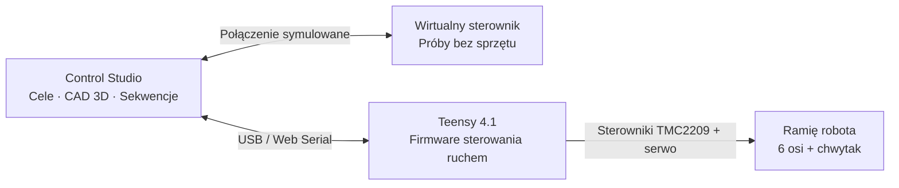

<p align="center"><a href="README.md" lang="en">English</a> · <strong>Polski</strong></p>

<p align="center">
  
</p>

<p align="center">
  <strong>Precyzyjne prace elektroniczne. Sześć osi. Sterowanie w przeglądarce.</strong><br>
  <sub>Teensy 4.1 · 6 osi + chwytak · Cyfrowy bliźniak CAD · Wbudowany symulator</sub>
</p>

<p align="center">
  <a href="#wypróbuj-bez-robota">Wypróbuj lokalnie</a> &nbsp; / &nbsp;
  <a href="docs/GETTING_STARTED.pl.md">Pierwsze kroki</a> &nbsp; / &nbsp;
  <a href="docs/STPPE_SYSTEM_SPECIFICATION.pl.md">Specyfikacja</a> &nbsp; / &nbsp;
  <a href="docs/ROADMAP.pl.md">Plan rozwoju</a> &nbsp; / &nbsp;
  <a href="CONTRIBUTING.pl.md">Współpraca</a>
</p>

---

## Stanowisko do precyzyjnego sterowania ruchem

STPPE Reborn to projekt teleoperowanego ramienia robota do delikatnych prac serwisowych przy elektronice i mikromontażu. Celem jest zastąpienie ręcznych ruchów pod mikroskopem ruchem kontrolowanym i powtarzalnym: ustawieniem narzędzia, sprawdzeniem pozycji docelowej w 3D i przygotowaniem sekwencji do ponownego odtworzenia.

**Control Studio** łączy model CAD robota, pozycjonowanie kartezjańskie, sterowanie poszczególnymi osiami, edycję trajektorii i telemetrię w przeglądarce. Wirtualny sterownik pozwala poznać oprogramowanie bez fizycznego robota. Aplikacja działa bezpośrednio z plików źródłowych, bez etapu budowania frontendu.

*STPPE: System Teleoperacyjny do Precyzyjnych Prac Elektronicznych.*

| Ustaw pozycję | Obserwuj ruch | Przygotuj sekwencję |
| :--- | :--- | :--- |
| Cele kartezjańskie, sterowanie osiami i gotowe ustawienia orientacji nadgarstka. | Ramię 3D na podstawie CAD, cień pozycji docelowej, obszar roboczy i widoki kamery. | Oś czasu punktów trajektorii, podgląd ruchu i sterowanie odtwarzaniem. |
| Osobne tryby podglądu celu i bezpośredniego sterowania. | Telemetria osi, pozycja narzędzia i konsola poleceń. | Wirtualny sterownik do eksperymentów przed próbami na stanowisku. |

## Podgląd Control Studio

[](docs/assets/webcontrol-dashboard.png)

*Interfejs przy odłączonym robocie: sterowanie po lewej, model CAD pośrodku, telemetria i konsola poniżej. Kliknij obraz, aby zobaczyć pełną rozdzielczość. Zrzut przedstawia angielską wersję interfejsu.*

## Wypróbuj bez robota

Potrzebujesz **Pythona 3** i przeglądarki obsługującej WebGL. Node.js jest potrzebny tylko do uruchamiania testów JavaScript.

```bash
git clone https://github.com/adammotyl22-creator/STPPE-Reborn.git
cd STPPE-Reborn
python WebControl/launch.py
```

Skrypt otworzy przeglądarkę i wypisze lokalny adres aplikacji. W Windows możesz zastąpić `python` poleceniem `py`, a w macOS/Linux — `python3`, jeśli tak jest zainstalowany Python. Możesz też pobrać i rozpakować repozytorium przez **Code → Download ZIP**.

1. Kliknij wskaźnik **Rozłączono (Disconnected)** w nagłówku, aby otworzyć menu połączenia. Możesz tam również przełączyć język interfejsu (PL / EN).
2. Zaznacz opcję **Symulacja (Mock)** i kliknij **Połącz**, aby uruchomić wirtualny sterownik Teensy.
3. W zakładce **Pozycjonowanie TCP (IK)** dostosuj współrzędne docelowe i obserwuj bursztynowy cień (Ghost) ramienia. Kliknij **Wykonaj ruch PTP**, aby zasymulować dojazd do celu.
4. Przejdź do zakładki **Sekwencer**, aby przetestować tworzenie sekwencji trajektorii, a na dolnym panelu sprawdź wykresy telemetrii w czasie rzeczywistym i konsolę poleceń.

Nie musisz budować frontendu, uruchamiać `npm install` ani instalować dodatkowych pakietów Pythona. Pozostaw skrypt uruchomiony; po zakończeniu naciśnij `Ctrl+C` w terminalu.

Połączenie USB, dostęp przez sieć lokalną i rozwiązywanie problemów opisuje [instrukcja uruchomienia](docs/GETTING_STARTED.pl.md).

## Od przeglądarki do stanowiska



Aplikacja zawiera również obsługę Wi-Fi/WebSocket. Wymaga ona osobnego, zgodnego mostka komunikacyjnego; skrypt Pythona udostępnia interfejs, ale nie przekazuje poleceń USB. Dedykowany panel ręczny i wdrożenie mostka są ujęte w [planie rozwoju](docs/ROADMAP.pl.md).

## Stan projektu

| Obszar | Obecny stan |
| :--- | :--- |
| Control Studio | Repozytorium zawiera kompletną aplikację przeglądarkową, fotorealistyczne modele CAD, symulator wirtualnego sprzętu oraz testy automatyczne. |
| Testy oprogramowania | **618/618 sprawdzeń zakończonych powodzeniem** w głównym zestawie Node.js (25 zestawów testowych); podstawowy test serwera Pythona również przeszedł pomyślnie. To wyniki lokalne, a nie status CI. |
| Sprzęt | Specyfikacja opisuje konstrukcję pracującą w otwartej pętli, bez zamontowanych enkoderów. Dostosowanie firmware i weryfikacja na stanowisku pozostają w planie rozwoju. |
| Dokładność i koszt | Błąd pozycjonowania końcówki ≤ 0,5 mm i budżet poniżej 2000 PLN to **założenia projektowe**, a nie opublikowane wyniki pomiarów. |

Specyfikacja obejmuje zachowania, które nie zostały jeszcze wdrożone. Obecny firmware nie zawiera flag `ENABLE_ENCODERS` / `MANUAL_HOMING`, a samo polecenie `HOME` uruchamia bazowanie z użyciem krańcówek. Przed użyciem specyfikacji jako instrukcji sprzętowej przeczytaj [uwagi dotyczące podłączania robota](docs/GETTING_STARTED.pl.md#podłączanie-fizycznego-robota).

## Kolejne etapy

1. **Dostosowanie firmware do konstrukcji** — jawna konfiguracja enkoderów i bazowania, opis poleceń oraz powtarzalna kompilacja.
2. **Publikacja wyników prób** — kalibracja osi, pomiary powtarzalności i nagranie demonstracji ruchu.
3. **Ułatwienie odtworzenia projektu** — schematy połączeń, lista części, instrukcje montażu i automatyczne testy.
4. **Rozbudowa teleoperacji** — dedykowany panel ręczny i udokumentowany mostek bezprzewodowy.

Zobacz [pełny plan rozwoju i kryteria ukończenia etapów](docs/ROADMAP.pl.md).

## Zawartość repozytorium

| Od czego zacząć | Co znajdziesz |
| :--- | :--- |
| [Pierwsze kroki](docs/GETTING_STARTED.pl.md) | Instrukcję symulatora, opcje połączenia i rozwiązywanie problemów |
| [Specyfikacja systemu](docs/STPPE_SYSTEM_SPECIFICATION.pl.md) | Wymiary, elektronikę, założenia działania i uwagi o stanie implementacji |
| [Control Studio](WebControl/) | Aplikację, moduły JavaScript, style i skrypt uruchamiający |
| [Firmware Teensy](Firmware/Teensy_4.1/IK_Control/IK_Control.ino) | Kod sterownika i obsługę poleceń |
| [Geometria robota](WebControl/urdf/) · [Modele CAD](WebControl/meshes/) | Opis modelu i siatki używane w wizualizacji |
| [Testy](WebControl/tests/) | Główny zestaw testów i dodatkowe sprawdzenia |
| [Współpraca](CONTRIBUTING.pl.md) | Zgłaszanie problemów, proponowanie funkcji i wprowadzanie zmian |

## Uruchamianie testów

W głównym katalogu repozytorium:

```bash
node WebControl/tests/run_tests_node.js
python WebControl/tests/test_server.py
```

Pierwsze polecenie sprawdza logikę aplikacji, obsługę protokołu, kinematykę i zgodność elementów interfejsu. Drugie sprawdza udostępnianie głównych plików aplikacji przez serwer lokalny. Testy te nie potwierdzają fizycznej dokładności pozycjonowania ani poprawnej kompilacji firmware.

Masz powtarzalny błąd lub pomysł na ulepszenie? [Utwórz zgłoszenie](https://github.com/adammotyl22-creator/STPPE-Reborn/issues), opisując konfigurację i zaobserwowane zachowanie. Pomocne są również poprawki dokumentacji, uwagi z prób symulatora i wyniki pomiarów.

---

<p align="center"><sub>STPPE Reborn · Teensy 4.1 + JavaScript + Three.js</sub></p>
