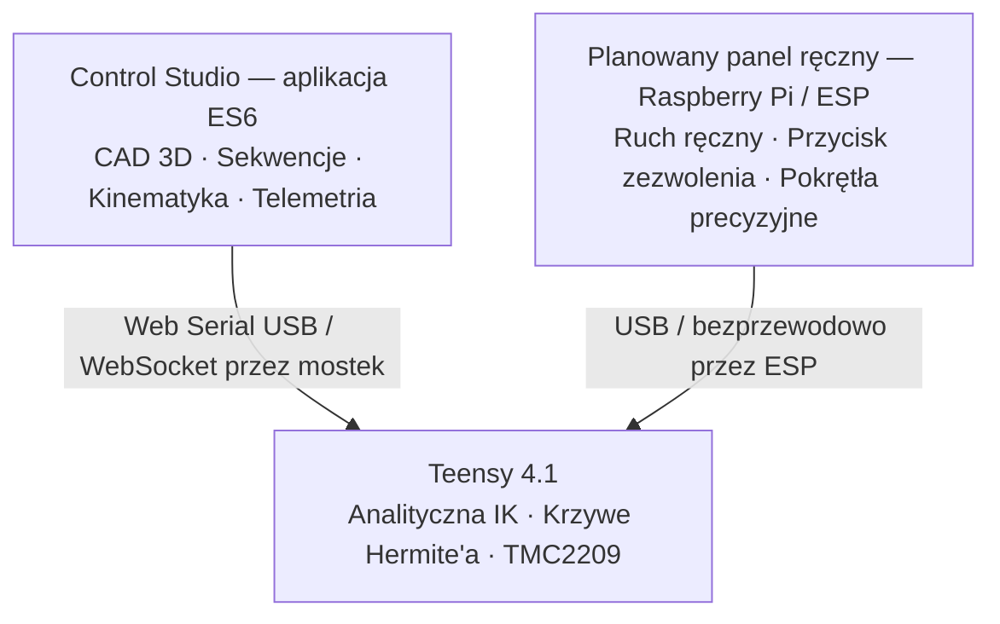

# STPPE Reborn — pełna specyfikacja i architektura systemu

[English](STPPE_SYSTEM_SPECIFICATION.md) · **Polski**

> **System Teleoperacyjny do Precyzyjnych Prac Elektronicznych**
>
> Platforma do precyzyjnego serwisowania elektroniki i mikromontażu.

> **Stan implementacji — 13.10.2026:** Dokument łączy założenia projektowe z istniejącymi funkcjami. Obecny szkic **nie definiuje** `ENABLE_ENCODERS` ani `MANUAL_HOMING`; samo `HOME` uruchamia bazowanie na krańcówkach, a `HOME MANUAL` przyjmuje zerowe kąty jako odniesienie zamiast proponowanej poniżej pozycji startowej. Przykłady protokołu również wymagają uzgodnienia z implementacją. Dokładność i koszt są założeniami projektowymi. Aktualne uwagi znajdziesz w [instrukcji uruchomienia](GETTING_STARTED.pl.md#podłączanie-fizycznego-robota), a kryteria ukończenia prac w [planie rozwoju](ROADMAP.pl.md).

[Opis projektu](../README.pl.md) · [Pierwsze kroki](GETTING_STARTED.pl.md) · [Plan rozwoju](ROADMAP.pl.md)

---

## 1. Opis i cel projektu

- **Pełna nazwa:** System Teleoperacyjny do Precyzyjnych Prac Elektronicznych (STPPE).
- **Nazwa projektu:** STPPE Reborn.
- **Główny cel:** ergonomiczna, precyzyjna platforma teleoperowana do delikatnych napraw elektroniki, układania elementów SMD (do rozmiarów 0603/0402), pozycjonowania BGA i prac lutowniczych.
- **Założone korzyści:** eliminacja wpływu drżenia dłoni podczas pracy pod mikroskopem, błąd pozycjonowania końcówki ≤ 0,5 mm (weryfikacja fizyczna pozostaje do wykonania), modułowa konstrukcja w budżecie poniżej 2000 PLN oraz wizualizacja cyfrowego bliźniaka CAD i planowanie sekwencji w czasie rzeczywistym.

## 2. Konstrukcja mechaniczna i kinematyka

### 2.1 Układ kinematyczny

- **Konfiguracja:** szeregowe ramię przegubowe o 6 stopniach swobody oraz chwytak o 1 stopniu swobody — łącznie 7 sterowanych osi.
- **Model kinematyczny:** `stppe_zlozenie_nowe`, zgodny ze standardem URDF.
- **Konstrukcja:** drukowane w 3D elementy nośne, precyzyjne łożyska kulkowe i przekładnie redukcyjne.

### 2.2 Geometria członów i przesunięcia

| Parametr | Wartość | Odniesienie fizyczne |
| :--- | :--- | :--- |
| **H_base — wysokość podstawy** | 143,896 mm | Od płaszczyzny montażowej do osi obrotu barku J2 |
| **L1 — ramię** | 185,845 mm | Od osi barku J2 do osi łokcia J3 |
| **L2 — przedramię** | 225,478 mm | Od osi łokcia J3 do środka nadgarstka J5 |
| **L3 — nadgarstek** | 36,105 mm | Od środka J5 do kołnierza mocowania narzędzia J6 |
| **L_tool — przesunięcie promieniowe narzędzia** | 31,530 mm | Od kołnierza do punktu centralnego narzędzia (TCP) |
| **Kąt spoczynkowy narzędzia** | 4,896° (0,08545 rad) | Stałe pochylenie efektora |

### 2.3 Zakresy ruchu osi

| Oś | Rodzaj ruchu | Kąt minimalny | Kąt maksymalny | Przełożenie / napęd |
| :--- | :--- | :--- | :--- | :--- |
| **J1** | Obrót podstawy | −90,0° | +90,0° | Przekładnia pasowa **8,33:1** |
| **J2** | Pochylenie ramienia | −65,0° | +115,0° | Przekładnia redukcyjna **20:1** |
| **J3** | Zgięcie łokcia | −35,0° | +170,0° | Przekładnia redukcyjna **20:1** |
| **J4** | Obrót przedramienia | −90,0° | +90,0° | Napęd bezpośredni / przekładnia nadgarstka |
| **J5** | Pochylenie nadgarstka | −120,0° | +120,0° | Napęd bezpośredni / przekładnia nadgarstka |
| **J6** | Obrót narzędzia | −180,0° | +180,0° | Napęd bezpośredni / przekładnia nadgarstka |

### 2.4 Ograniczenia przestrzeni roboczej

- **Prześwit nad podłożem:** walidator obszaru roboczego wymaga co najmniej Z ≥ 20,0 mm.
- **Strefa wyłączenia wokół podstawy:** r² ≥ 6400 mm², czyli r ≥ 80,0 mm, aby ograniczyć możliwość kolizji z kolumną podstawy.

## 3. Elektronika i napędy

### 3.1 Płytka sterownika

- **Mikrokontroler:** Teensy 4.1 — NXP i.MX RT1062, ARM Cortex-M7, 600 MHz.
- **Firmware:** [`IK_Control.ino`](../Firmware/Teensy_4.1/IK_Control/IK_Control.ino), wersja v3.2.0.

### 3.2 Silniki krokowe i sterowniki

- **Sterowniki:** 6 × TMC2209.
- **Linie sterujące:** szybkie sygnały `STEP` / `DIR` / `EN`, obsługiwane z użyciem timerów sprzętowych Teensy.
- **Konfiguracja przez UART:** `Serial4`, rezystor pomiarowy R_sense = 0,11 Ω; programowe ustawianie prądu pracy i podtrzymania, trybu StealthChop oraz mikrokroków z interpolacją 1/256.

| Oś | STEP | DIR | EN |
| :--- | :--- | :--- | :--- |
| J1 — podstawa | 3 | 2 | 6 |
| J2 — ramię | 11 | 10 | 27 |
| J3 — łokieć | 29 | 28 | 32 |
| J4 — obrót przedramienia | 34 | 33 | 12 |
| J5 — pochylenie nadgarstka | 31 | 30 | 12 |
| J6 — obrót narzędzia | 23 | 22 | 12 |

**Serwo chwytaka:** PWM na pinie 21.

### 3.3 Enkodery i sprzężenie zwrotne

**Obecny sprzęt:** silniki krokowe pracują w otwartej pętli; enkodery nie są zamontowane. Ruch jest zadawany mikrokrokami z wykorzystaniem TMC2209 i StealthChop.

**Kierunek rozwoju:** obsługa absolutnych enkoderów magnetycznych AS5600 na głównych osiach; AS5048A przez SPI jest rozważaną alternatywą. Planowana flaga `#define ENABLE_ENCODERS false` ma umożliwić pracę bez enkoderów. Nie jest jeszcze wdrożona, a przyszła konfiguracja zamkniętej pętli będzie wymagała kalibracji i sprawdzenia.

### 3.4 Bazowanie i pozycja odniesienia

**Planowana strategia:** ręczne bazowanie przy uruchomieniu; implementacja pozostaje do wykonania.

Proponowana procedura zakłada włączanie robota ustawionego w mechanicznej pozycji odniesienia `Home: [0.0°, 25.0°, 140.0°, 0.0°, 0.0°, 0.0°]`. Po kolizji lub zaniku zasilania operator miałby ręcznie ustawić ramię według znaczników i ponownie uruchomić lub włączyć sterowanie.

Planowana flaga `#define MANUAL_HOMING true` ma pomijać automatyczne bazowanie na krańcówkach. Nie jest jeszcze wdrożona; samo `HOME` uruchamia obecnie bazowanie na krańcówkach.

## 4. Efektor i narzędzia

- **Aktywny efektor:** precyzyjny mikrochwytak napędzany serwem, podłączonym do pinu PWM 21.
- **Pozostałe narzędzia:** lutownice, dysze gorącego powietrza, mikroskopy inspekcyjne i dozowniki topnika pozostają osobnymi elementami stanowiska. Ogranicza to masę i bezwładność efektora.

## 5. Interfejsy sterowania i teleoperacja

Docelowa architektura obejmuje aplikację komputerową oraz dedykowany panel ręczny:



### 5.1 Główny interfejs: Control Studio

- **Technologia:** aplikacja jednostronicowa ES6 bez etapu budowania, z wizualizacją CAD w Three.js.
- **Tryby wykonania:** podgląd pozycji docelowej z bursztynowym cieniem ramienia oraz jawnie włączane śledzenie na żywo. Podgląd pozwala sprawdzić zmiany celu przed wysłaniem; jawne polecenia wykonania ruchu są opisane w [instrukcji uruchomienia](GETTING_STARTED.pl.md).
- **Sterowanie przez przytrzymanie:** próg 250 ms, narastanie prędkości według krzywej S i ograniczenie częstotliwości pakietów do 20 Hz.
- **Kinematyka:** analityczna kinematyka odwrotna (IK 6-DOF) z rozprzężeniem sferycznego nadgarstka oraz bezpośrednie sterowanie osiami (FK J1–J6).
- **Orientacja narzędzia:** pełny tryb 6-DOF (kąty Eulera Roll / Pitch / Yaw) oraz 7 analitycznych trybów nadgarstka: W0 (poziomo, równolegle do podłoża), W1 (pionowo w dół, Roll 0°), W2 (pionowo w dół, Roll 90°), W3–W5 (oś narzędzia w płaszczyźnie poziomej z obrotem Roll 0°, 90°, 180°), W6 (ręczne bezpośrednie nastawy kątów).
- **Trajektorie i wygładzanie:** wielopunktowa kolejka wyprzedzająca FIFO (Lookahead) z ciągłym zaokrąglaniem naroży wielomianami Hermite'a 5. stopnia klasy C² oraz interpolacją liniową w przestrzeni kartezjańskiej (`MOVL`).
- **Testy automatyczne:** **618 sprawdzeń w 25 zestawach testowych** w [`run_tests_node.js`](../WebControl/tests/run_tests_node.js), 100% testów zaliczonych pomyślnie.

### 5.2 Planowany ręczny panel sterowania (Teach Pendant)

- **Platforma:** dedykowana obudowa przemysłowa z Raspberry Pi lub mikrokontrolerem czasu rzeczywistego (ESP32-S3).
- **Elementy sterujące:** dwa precyzyjne manipulatory drążkowe (joysticki analogowe), zadajnik kółkowy / impulsator MPG do mikropozycjonowania osi, trójpozycyjny przycisk zezwolenia na ruch (Deadman / Enabling switch) oraz grzybkowy wyłącznik zatrzymania awaryjnego (E-STOP).
- **Połączenie przewodowe:** bezpośrednie połączenie USB Host / UART do kontrolera Teensy.
- **Połączenie bezprzewodowe:** mostek Wi-Fi / ESP do portu szeregowego; determinizm czasowy, niskie opóźnienia i natychmiastowe zatrzymanie przy utracie sygnału pozostają krytycznymi wymaganiami bezpieczeństwa.

## 6. Protokoły i formaty komunikacji

Poniższy opis przedstawia założenia protokołu, a nie zweryfikowaną listę poleceń. Przed użyciem przykładów ze sprzętem sprawdź aktualny parser firmware i moduł tworzenia pakietów w aplikacji. Nazwy poleceń, formaty argumentów i pola telemetrii wymagają uzgodnienia w ramach planu rozwoju.

### 6.1 Polecenia do sterownika

Ramki wykorzystują Dallas/Maxim CRC-8, wielomian `0x31`.

**Ruch punkt–punkt / trajektoria:**

```text
<j1, j2, j3, j4, j5, dx, dy, dur, crc>
```

**Polecenia systemowe w opisie projektu:**

- `STOP\n` — zatrzymanie ruchu; dokładne zachowanie należy sprawdzić w bieżącym parserze.
- `HOME\n` — obecnie uruchamia bazowanie na krańcówkach; nie realizuje proponowanego ręcznego odniesienia przy starcie.
- `GRIP:<0-100>\n` — projektowy format zadawania procentowego otwarcia chwytaka.
- `OVR:<0.0-1.0>\n` — projektowy format globalnego współczynnika prędkości.

### 6.2 Telemetria ze sterownika

Projekt zakłada strumień JSON `JTELEM` o częstotliwości 10 Hz. Przykład poniżej wymaga porównania z rzeczywistymi polami emitowanymi przez firmware:

```json
{
  "t": 128450,
  "joints": [0.0, 25.0, 140.0, 0.0, 0.0, 0.0],
  "target": [0.0, 25.0, 140.0, 0.0, 0.0, 0.0],
  "tcp": {"x": 220.4, "y": 0.0, "z": 150.2},
  "grip": 0,
  "queue": 0,
  "homed": true,
  "estop": false,
  "status": "IDLE"
}
```

## 7. Organizacja repozytorium

| Katalog / plik | Zawartość | Stan |
| :--- | :--- | :--- |
| [`WebControl/`](../WebControl/) | Aplikacja Control Studio, testy, zasoby i skrypt uruchamiający | Główna rozwijana wersja |
| [`Firmware/Teensy_4.1/`](../Firmware/Teensy_4.1/) | Firmware `IK_Control.ino`; konfiguracja wymaga dopasowania do sprzętu | Rozwijany kod źródłowy |
| [`docs/`](../docs/) | Architektura, ilustracje i specyfikacje techniczne | Aktualna dokumentacja |
| `WebControl-v2`, `v3`, `v4` | Historyczne eksperymenty z interfejsem i układem paneli | Lokalne archiwa testowe, wyłączone z Git |

## 8. Plan wdrożenia

1. **Konfiguracja firmware:** dodać `#define ENABLE_ENCODERS false` i `#define MANUAL_HOMING true` w [`IK_Control.ino`](../Firmware/Teensy_4.1/IK_Control/IK_Control.ino), aby obsłużyć obecną konstrukcję bez enkoderów i uniknąć zależności od nieobecnych czujników oraz krańcówek.
2. **Próby pojedynczych osi:** po przygotowaniu konfiguracji połączyć Teensy przez USB Web Serial z Control Studio, zasilić napędy z magistrali 12 V / 24 V i sprawdzić ruch J1–J6 oraz kierunki osi.
3. **Porządkowanie katalogów:** uporządkować lub bezpiecznie zarchiwizować lokalne `WebControl-v2`, `v3` i `v4`, utrzymując `WebControl/` jako główną wersję aplikacji.
4. **Panel ręczny Raspberry Pi:** opracować klienta panelu i mostek ESP do bezprzewodowej teleoperacji na stanowisku.

Szczegółowe kryteria ukończenia opisuje [plan rozwoju](ROADMAP.pl.md).
